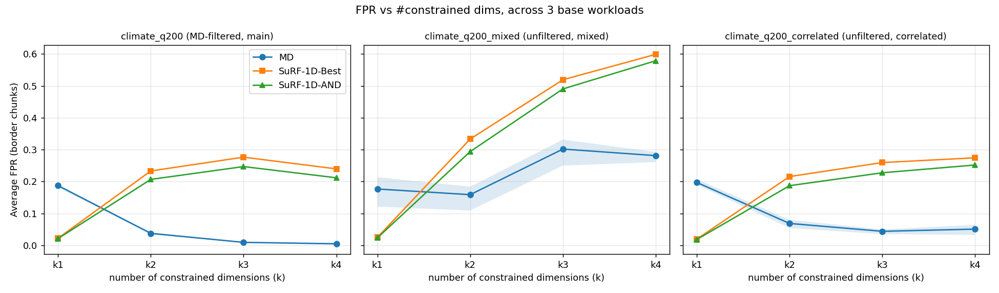
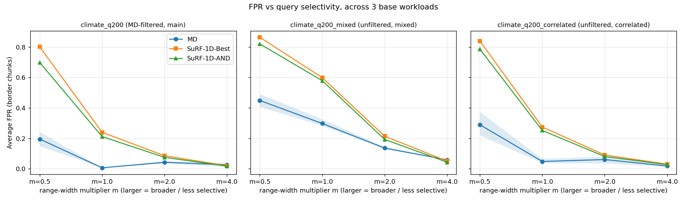

# 中性基负载复核（维度消融 + 选择度扫描）

本目录是 `../`（维度消融 + 选择度扫描）的**增量复核**，全程**只新增文件，不修改任何既有代码或既有结果**。

## 为什么要做这个

父研究的两个基负载都各有一个"可被审稿人挑"的点：

- `q200`：主实验负载，但它是**按 MD 实测 FPR≤0.1 筛选**出来的 → 对 MD 有选择偏差。
- `q200_mixed`：未筛选，但维度消融里 MD 曲线**非单调**（k2→k3 从 0.159 跳到 0.302），不好看。

因此补一个**未筛选、命中充足、固定种子可复现**的基负载 `climate_q200_correlated`
（数据跟随查询：围绕真实元组扩展区间，200/200 命中，命中数中位数 99.5），
在完全相同口径下复核结论，消除"只在筛选过的负载上成立"的质疑。

> 注：曾尝试"纯均匀随机"中性负载，但 4 维空间过于稀疏（仅 63/200 命中，命中中位数 0），
> MD 绝对 FPR 高达 0.65、nan 多、噪声大，不适合做中性基负载，已弃用。

## 固定条件（与父研究完全一致）

| 项 | 值 |
|----|----|
| 数据集 | `data/test/climate/data.txt`（1459 元组） |
| d | {4,1121,68,7} |
| logical_size | {2,16,16,4} |
| bitsperkey | 20（MD 位图/布隆阈值） |
| SuRF real-suffix | 8（kReal） |
| MD 重复 | 3 次（非确定性，取均值 + min/max） |
| SuRF | 确定性，单次 |
| 变体 | 维度消融 k1..k4；选择度 m=0.5/1/2/4 |

## 目录结构

```
experiments/ablations/neutral/
├── run_study_correlated.py    # 在 q200_correlated 上生成变体+运行+聚合（增量）
├── plot_3base.py              # 三基负载对比图（线性轴·基础版）
├── plot_pretty.py             # 论文风格合并图（2x3 / 1x3，对数轴）
├── plot_individual.py         # 出主图基负载 q200_correlated 单独图（英文标注；维度消融图无标题）→ results/individual/
├── queries/q200_correlated/{dimablation/k1..k4, selectivity/m0p5..m4p0}/query.txt
├── runs/q200_correlated/<study>/<variant>/{md_rep1..3/result.txt, surf/}
└── results/
    ├── detail_correlated.tsv        # 本基负载逐变体明细（含 md_min/max）
    ├── detail_all.tsv               # 三基负载明细合并
    ├── dimablation_3base.csv        # 维度消融·三基负载·中文表头
    ├── selectivity_3base.csv        # 选择度·三基负载·中文表头
    ├── fpr_vs_dimcount_3base.png
    ├── fpr_vs_selectivity_3base.png
    ├── comparison_2x3.png / fpr_vs_dimcount_pretty.png / fpr_vs_selectivity_pretty.png
    └── individual/                  # 单独图（英文标注）；仅保留主图基负载 q200_correlated
        ├── 维度消融_Q200相关_未筛选.png    # 维数消融主图
        └── 选择度_Q200相关_未筛选.png      # 选择度扫描主图
```

## 结果（平均 FPR）

### 维度消融（k=1..4），三种基负载

| k | q200（筛过）MD / Best / AND | q200_mixed（未筛·混合）MD / Best / AND | **q200_correlated（未筛·相关）MD / Best / AND** |
|---|---|---|---|
| 1 | 0.187 / 0.022 / 0.021 ← SuRF | 0.176 / 0.025 / 0.023 ← SuRF | 0.197 / 0.019 / 0.018 ← SuRF |
| 2 | 0.037 / 0.233 / 0.207（6×） | 0.159 / 0.333 / 0.294（~2×） | **0.068 / 0.215 / 0.187（~3×）** |
| 3 | 0.009 / 0.276 / 0.247（27×） | 0.302 / 0.519 / 0.490（~1.7×） | **0.044 / 0.259 / 0.227（~6×）** |
| 4 | 0.005 / 0.240 / 0.212（50×） | 0.281 / 0.599 / 0.579（~2×） | **0.051 / 0.274 / 0.252（~5×）** |

**结论**：在**未筛选**的相关负载上，`k=1` 时 SuRF 仍胜（1D 查询用 1D 过滤器本就合适）；
**`k≥2` 起 MD 一致更低**，且随约束维数增加差距扩大（约 3×→6×→5×）。
`q200_correlated` 的 MD 曲线 0.197→0.068→0.044→0.051 基本单调，比 `q200_mixed` 干净，
可直接作为"未筛选、无偏"的主图证据；`q200` 作为"筛选过的主实验"补充。

### 选择度扫描（m=0.5/1/2/4），三种基负载

| m | q200 MD / Best / AND | q200_mixed MD / Best / AND | **q200_correlated MD / Best / AND** |
|---|---|---|---|
| 0.5（极窄） | 0.195 / 0.800 / 0.698 | 0.449 / 0.863 / 0.820 | **0.289 / 0.839 / 0.786** |
| 1.0（原始） | 0.007 / 0.240 / 0.212 | 0.298 / 0.599 / 0.579 | **0.048 / 0.274 / 0.252** |
| 2.0（变宽） | 0.043 / 0.086 / 0.075 | 0.136 / 0.214 / 0.193 | **0.061 / 0.091 / 0.081** |
| 4.0（极宽） | 0.027 / 0.020 / 0.018 ← SuRF | 0.059 / 0.051 / 0.044 ← SuRF | **0.019 / 0.031 / 0.028 ← SuRF** |

**结论**：中低选择度（m≤2）MD 更低；**区间极宽（m=4，覆盖约 76% 值域）时几乎所有块都真命中、
过滤失去意义，SuRF 略优**——三种基负载表现一致，边界稳定可复现。

## 结论可用性与边界（写论文照此表述）

1. **可在正文写**：约束维数 k≥2 的多维区域查询上，1D 过滤器 FPR 随维数升高而恶化，MD 保持低 FPR；
   该结论在**筛选负载 q200 与两个未筛选负载（mixed / correlated）上一致成立**。
2. **k=1 反例要主动给**：只有一维约束时 SuRF 优于 MD（1D 过滤器适用于 1D 查询），说明不是"作弊"。
3. **超宽区间反例要主动给**：m=4 时过滤失效、SuRF 略优。优势区间是"k≥2 且中低选择度"。
4. **MD 非确定性**（读页 `Can not seek!` bug）仍在，MD 报 3 次均值 + min/max；修掉后曲线更平滑。





## 复现

```bash
# 在仓库根目录
python3 experiments/ablations/neutral/run_study_correlated.py   # 生成变体+运行+聚合
python3 experiments/ablations/neutral/plot_3base.py             # 出图（线性基础版）
python3 experiments/ablations/neutral/plot_pretty.py            # 出图（论文风格合并图）
python3 experiments/ablations/neutral/plot_individual.py        # 出 6 张单独图（英文标注）
```
